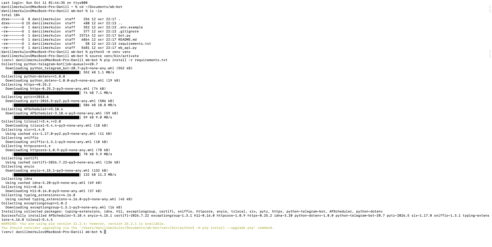
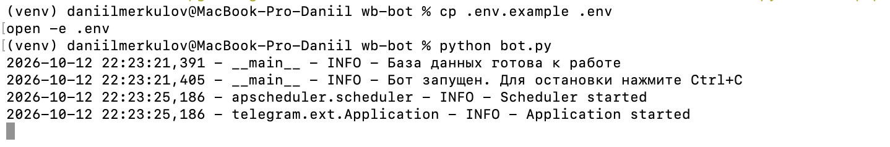
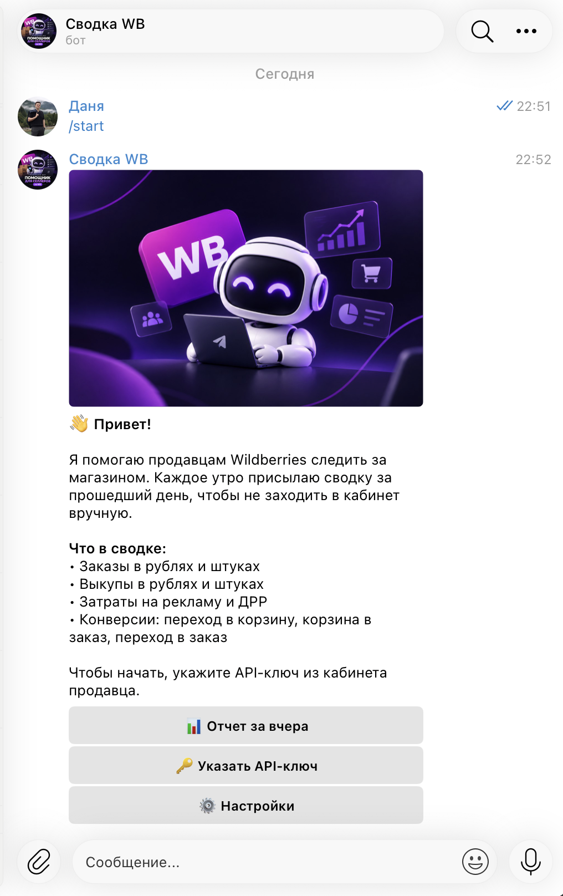
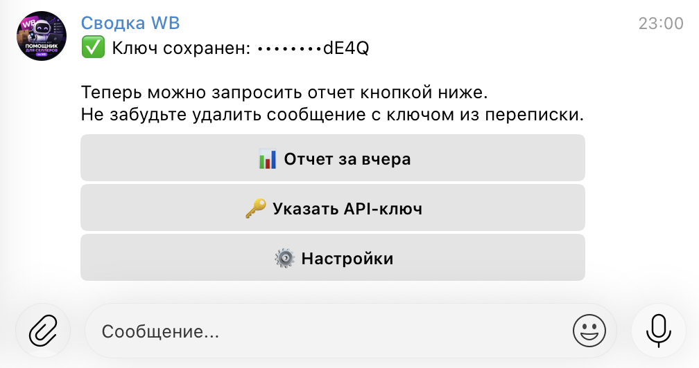
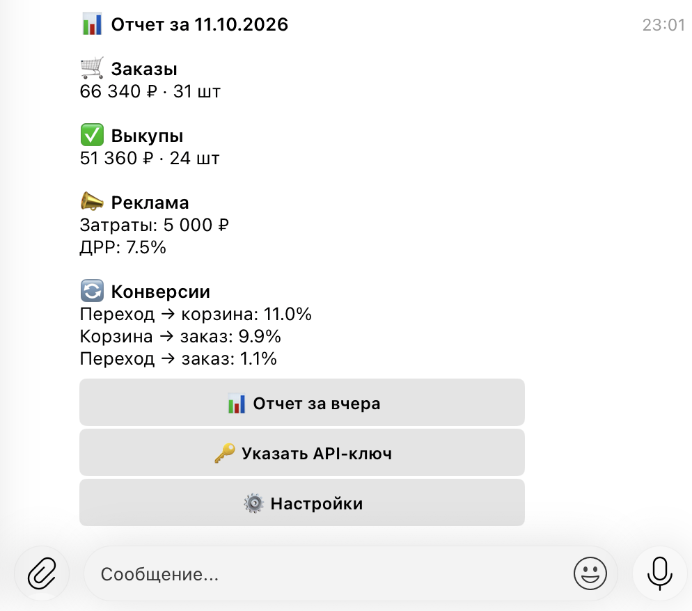
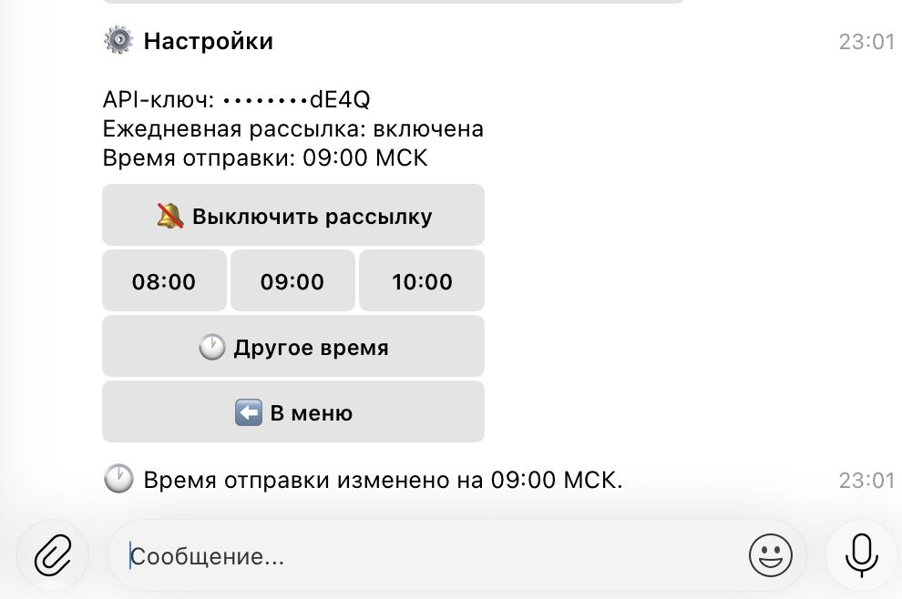

University: [ITMO University](https://itmo.ru/ru/)
Faculty: [FICT](https://fict.itmo.ru)
Course: [Vibe Coding: AI-боты для бизнеса](https://github.com/itmo-ict-faculty/vibe-coding-for-business)
Year: 2025/2026
Group: U4125
Author: Merkulov Daniil Vyacheslavovich
Lab: Lab1
Date of create: 12.10.2026
Date of finished: [указать после защиты]

## Описание задачи

Я продаю одежду на Wildberries, поэтому взял задачу из своей работы. Каждое утро я захожу в кабинет продавца и смотрю одни и те же цифры за вчера: сколько заказали, сколько выкупили, сколько ушло на рекламу. Кабинет грузится небыстро, цифры разбросаны по разным отчетам, и на это уходит минут десять. Если день пропустил, то потом сложно понять, когда именно что-то пошло не так.

Бот решает ровно эту проблему: присылает сводку сам, в девять утра по Москве, одним сообщением. Отдельно можно запросить отчет кнопкой в любой момент.

Бот в Telegram: [@itmoftmi_mdv_bot](https://t.me/itmoftmi_mdv_bot)

Что в сводке:

- Заказы в рублях и в штуках
- Выкупы в рублях и в штуках
- Затраты на рекламу
- ДРР, то есть доля рекламных расходов
- Конверсия из перехода в корзину
- Конверсия из корзины в заказ
- Конверсия из перехода в заказ

Бот сделан не только под мой магазин. Каждый пользователь отправляет боту свой API-ключ из кабинета продавца, ключ сохраняется персонально, и данные тянутся именно по его магазину. Время рассылки тоже у каждого свое.

Из четырех вариантов в методичке это ближе всего к «боту-агрегатору информации»: он собирает данные из внешнего источника и присылает сводку.

## Промпт для LLM

Код я не писал руками, весь проект сгенерирован по промпту. Использовал Claude.

### Исходный промпт

```
Напиши Telegram-бота на Python для продавцов Wildberries.

Что делает бот: каждое утро в 9:00 по Москве присылает пользователю сводку
по его магазину за предыдущий день. Также пользователь может запросить отчет
за вчера вручную в любой момент.

Показатели в сводке:
- заказы в рублях и в штуках
- выкупы в рублях и в штуках
- затраты на рекламу
- ДРР (доля рекламных расходов)
- конверсия в корзину
- конверсия в заказ

Каждый пользователь загружает свой API-ключ от кабинета Wildberries,
данные тянутся по его магазину. Ключи разных пользователей не пересекаются.

Команды: /start, /help, /setkey, /report, /settings.
В настройках можно выбрать время рассылки и отключить ее совсем.
Управление кнопками, а не только командами.

Требования к коду:
- библиотека python-telegram-bot версии 20
- данные пользователей в SQLite
- токен бота через переменную окружения, в коде его быть не должно
- комментарии в коде на русском, понятные новичку
- обработка ошибок, бот не должен падать
- получение данных вынести в отдельный модуль wb_api.py и пока отдавать
  тестовые значения, чтобы потом заменить их на настоящий API

Создай файлы: bot.py, wb_api.py, requirements.txt с версиями,
README.md с пошаговой инструкцией запуска, .env.example, .gitignore
(исключить .env, базу данных, кэш Python).
Для каждого файла укажи имя и полный текст.
```

### Итерация 1: исправил расчет конверсий

В первой версии обе конверсии считались от числа переходов в карточку товара. Это неверно: конверсия в заказ по смыслу считается от корзины, а не от переходов. Уточнил:

```
Конверсия в корзину это переходы в корзину, то есть добавления в корзину
делятся на переходы в карточку. Конверсия в заказ это заказы, деленные
на добавления в корзину. Добавь еще третью конверсию: из перехода в заказ,
то есть заказы, деленные на переходы в карточку.
```

После правки в отчете стало три конверсии, и они сходятся между собой: 11.0% умножить на 9.9% дает 1.1%, то есть третья цифра получается из первых двух.

### Итерация 2: картинка в приветствии

Текстовое приветствие выглядело скучновато, попросил добавить картинку:

```
Добавь картинку в приветствие по команде /start. Файл лежит в папке images
рядом с кодом. Текст приветствия должен идти подписью под картинкой,
кнопки оставить. Если файла нет на месте, бот не должен падать,
пусть отправит приветствие текстом.
```

Отдельно в коде сделано так, что картинка грузится в Telegram один раз, а дальше отправляется по идентификатору, который Telegram вернул. Так приветствие не тормозит.

### Финальный промпт

Финальный промпт это исходный плюс обе правки. Полностью он лежит в файле [prompt.md](prompt.md).

## Стек технологий

| Технология | Зачем |
|---|---|
| Python 3.10 | основной язык, на нем же будет писаться работа с API Wildberries |
| python-telegram-bot 20.7 | библиотека для Telegram, берет на себя всю работу с Bot API |
| JobQueue | встроенный планировщик в этой же библиотеке, им сделана рассылка по времени |
| SQLite | база для хранения пользователей, идет вместе с Python, отдельный сервер не нужен |
| python-dotenv | читает токен из файла .env, чтобы не держать его в коде |
| zoneinfo | часовые пояса, через него задается Europe/Moscow |

Версии зафиксированы в `requirements.txt`. Это нужно, чтобы через полгода проект собрался так же, как сегодня, а не сломался из-за обновления библиотеки.

Отдельно про структуру. Получение данных вынесено в модуль `wb_api.py`, и сейчас он отдает тестовые цифры. Сделано это специально: во второй лабораторной нужно будет подключить настоящий API Wildberries, и менять придется только одну функцию внутри этого модуля. Остальной код бота трогать не надо, потому что формат данных останется тот же.

Хранение данных устроено так: одна таблица `users`, в ней telegram_id, API-ключ, время рассылки и признак, включена рассылка или нет. При запуске бот читает эту таблицу и заново ставит задачи на рассылку для всех, у кого она включена, иначе после перезапуска рассылка бы просто пропала.

Код бота лежит в папке [bot](bot), инструкция по запуску в [bot/README.md](bot/README.md).

## Скриншоты

Установка зависимостей:



Запуск бота:



Приветствие по команде /start:



Сохранение API-ключа:



Отчет за вчерашний день:



Настройки рассылки:



## Трудности и решения

**Конверсии считались неправильно.** LLM посчитала обе конверсии от переходов в карточку. Формально код работал, ошибки не было, но цифра получалась бессмысленная. Понял я это только потому, что знаю, как эти показатели считаются в кабинете. Вывод для себя: код, который сгенерировала модель, запускается и не падает, но это еще не значит, что он считает то, что нужно. Проверять надо по смыслу, а не по тому, есть ошибка в терминале или нет.

**Токен бота мог попасть в репозиторий.** Если вписать токен прямо в код, то при загрузке на GitHub он станет публичным, и ботом сможет управлять кто угодно. Поэтому токен лежит в файле `.env`, а сам файл добавлен в `.gitignore` и в репозиторий не попадает. В репозитории есть только `.env.example` с примером, куда что вписывать.

**API-ключи пользователей.** Та же история, только ключи чужие. Они хранятся в базе, база тоже в `.gitignore`. В интерфейсе бот показывает ключ не полностью, а только последние четыре символа, и в логи ключ не пишется. После сохранения бот просит удалить сообщение с ключом из переписки.

**Рассылка пропадала после перезапуска.** Задачи планировщика живут в памяти, поэтому при остановке бота они исчезают. Решается тем, что при старте бот проходит по базе и ставит задачи заново.

## Выводы

Получилось рабочее приложение, хотя код я не писал. За пару часов собрался бот с базой, планировщиком, кнопками и настройками. Руками, с моим уровнем, это заняло бы недели.

Главное, что понял: качество результата упирается в промпт. Чем точнее описано, что должно получиться, тем меньше потом правок. Фраза «конверсия в заказ» мне казалась однозначной, а модель поняла ее иначе, и это нормально, потому что я сам не уточнил, от чего считать. Как только написал формулу словами, все встало на место.

Второе наблюдение про проверку. Мне повезло, что я знаю предметную область и заметил неверную формулу. Если бы задача была из незнакомой сферы, ошибка спокойно дожила бы до сдачи. Поэтому проверять результат надо по смыслу, а не только по тому, запускается код или нет.

Что можно улучшить: сейчас данные тестовые, подключение настоящего API Wildberries будет во второй лабораторной. Еще бот живет только пока у меня открыт терминал, в третьей работе его нужно будет развернуть на сервере, чтобы работал постоянно. Из функционала напрашивается сравнение с позавчерашним днем, чтобы сразу видеть, вырос показатель или упал.
