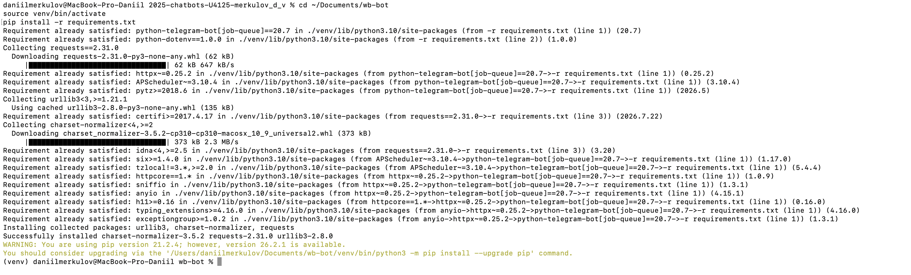
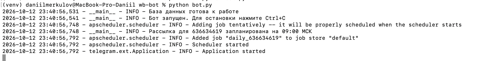
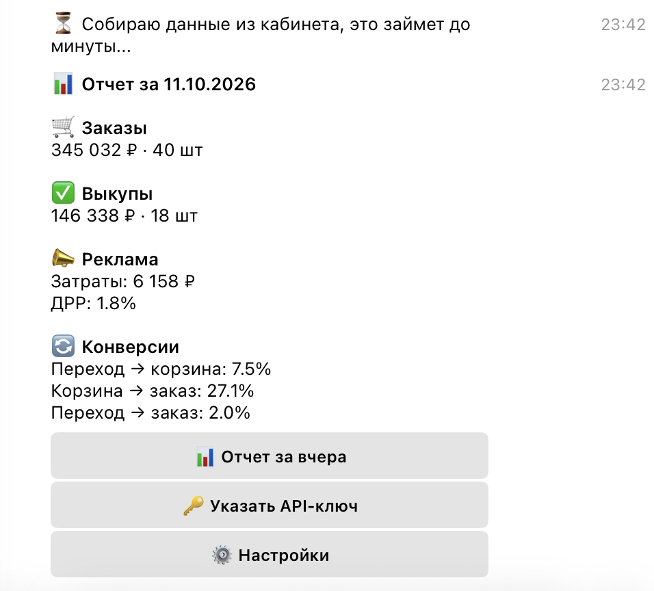

University: [ITMO University](https://itmo.ru/ru/)
Faculty: [FICT](https://fict.itmo.ru)
Course: [Vibe Coding: AI-боты для бизнеса](https://github.com/itmo-ict-faculty/vibe-coding-for-business)
Year: 2025/2026
Group: U4125
Author: Merkulov Daniil Vyacheslavovich
Lab: Lab2
Date of create: 12.10.2026
Date of finished: [указать после защиты]

## Описание интеграции

В первой лабораторной бот показывал тестовые цифры, которые сам же и придумывал. В этой работе я подключил настоящий источник данных: API кабинета продавца Wildberries. Теперь бот отдает реальные показатели моего магазина.

Из трех вариантов в методичке я выбрал внешний API.

Особенность в том, что у Wildberries это не один API, а несколько отдельных групп, у каждой свой адрес и свои лимиты. Нужные мне данные разбросаны по трем:

| Группа | Адрес | Что беру |
|---|---|---|
| Отчеты | statistics-api.wildberries.ru | заказы и выкупы, в рублях и в штуках |
| Продвижение | advert-api.wildberries.ru | затраты на рекламу |
| Аналитика | seller-analytics-api.wildberries.ru | воронка продаж, из нее конверсии |

Доступ дает один токен, но при его создании нужно отметить все три категории. Если не отметить хотя бы одну, то по этой части данных придет отказ. Токен живет 180 дней.

Авторизация простая: токен кладется в заголовок `Authorization` каждого запроса.

## Промпт для LLM

### Исходный промпт

```
Замени тестовые данные в моем Telegram-боте на настоящий API Wildberries.

Сейчас модуль wb_api.py возвращает выдуманные цифры. Нужно, чтобы он
брал их из кабинета продавца по API-ключу пользователя.

Что нужно получать за указанный день:
- заказы: сумма в рублях и количество
- выкупы: сумма в рублях и количество
- затраты на рекламу
- переходы в карточку товара и добавления в корзину, чтобы посчитать конверсии

Требования:
- формат словаря, который возвращает get_daily_stats, менять нельзя,
  остальной код бота должен остаться без изменений
- вчерашний день считать по московскому времени, а не по времени сервера
- обработка ошибок: если ключ неверный, истек или у него не хватает
  категорий доступа, пользователь должен получить понятное объяснение,
  а не слово "ошибка"
- учесть лимиты на частоту запросов
- комментарии в коде на русском

Сначала уточни по документации dev.wildberries.ru, какие методы актуальны
сейчас, какие у них адреса, параметры и имена полей в ответе.
Не бери это из памяти, методы могли измениться.
```

Последний абзац оказался самым важным во всей работе, почему, написано ниже в трудностях.

### Итерация 1: бот подвисал на время запроса

Первая версия работала, но пока бот ходил в Wildberries, он не отвечал вообще никому. Запросов четыре, часть из них идет долго, и на это время бот как будто зависал.

```
Пока бот собирает данные из Wildberries, он перестает отвечать другим
пользователям. Запросы обычные, не асинхронные. Выполняй их в отдельном
потоке, чтобы бот продолжал работать. И сразу после нажатия кнопки
отправляй сообщение, что данные собираются, чтобы человек не думал,
что бот сломался.
```

### Итерация 2: понятные сообщения об ошибках

Сначала на любую проблему бот отвечал одинаково: «не удалось получить данные, проверьте ключ». Понять по этой фразе, что не так, невозможно.

```
Сделай отдельный тип ошибки для проблем с Wildberries. Текст пиши
сразу для пользователя: если ключ не принят, объясни, что он мог истечь
или что при создании не отмечены нужные категории. Если превышен лимит
запросов, скажи подождать минуту. Технические коды ответов пользователю
не показывай, пиши их только в лог.
```

Финальный промпт лежит в файле [prompt.md](prompt.md).

## Реализация

Весь код интеграции собран в одном модуле `wb_api.py`. Остальной код бота не поменялся, кроме двух мест, где добавилась работа в отдельном потоке и обработка нового типа ошибки. Это получилось потому, что еще в первой работе модуль был сделан с запасом: формат данных на выходе остался тот же, просто вместо выдуманных цифр внутри теперь настоящие запросы.

### Какие методы используются

| Что получаю | Метод |
|---|---|
| Заказы | `GET /api/v1/supplier/orders?dateFrom=ДАТА&flag=1` |
| Выкупы | `GET /api/v1/supplier/sales?dateFrom=ДАТА&flag=1` |
| Реклама | `GET /adv/v1/upd?from=ДАТА&to=ДАТА` |
| Воронка | `POST /api/analytics/v3/sales-funnel/products` |

Параметр `flag=1` означает «отдай все заказы за эту дату». Без него API понимает дату иначе: как момент, начиная с которого произошли изменения, и выдает совсем другой набор строк.

### Как считаются показатели

Заказы приходят списком, где каждая строка это одна единица товара. Отмененные отсекаются по полю `isCancel`, сумма берется из `priceWithDisc`, то есть цены со скидкой продавца.

```python
orders = [row for row in rows if not row.get("isCancel")]
orders_count = len(orders)
orders_rub = sum(row.get("priceWithDisc", 0) for row in orders)
```

В выкупах сложнее: в один отчет попадают и продажи, и возвраты. Отличаются они первой буквой поля `saleID`, S это продажа, R это возврат на склад. Возвраты вычитаются, чтобы цифра показывала реальный результат дня. По возвратам суммы могут приходить с минусом, поэтому в коде берется модуль и вычитание делается явно: так формула верна в любом случае.

Конверсии считаются не по тем процентам, которые присылает API. Он отдает их по каждой карточке товара отдельно, а складывать или усреднять проценты нельзя, получится неверно. Поэтому из ответа берутся только счетчики, а проценты по магазину считаются из суммы:

```
Переход → корзина = добавления в корзину / переходы × 100
Корзина → заказ   = заказы / добавления в корзину × 100
Переход → заказ   = заказы / переходы × 100
```

ДРР считается как затраты на рекламу, деленные на сумму заказов.

### Лимиты запросов

У каждой группы API свой лимит, и его превышение сразу дает отказ:

- заказы и выкупы: не чаще одного запроса в минуту
- реклама: один запрос в секунду
- воронка: три запроса в минуту

В коде это учтено двумя способами. Воронка приходит страницами по 1000 карточек, и между страницами стоит пауза 21 секунда. А если Wildberries все же ответил отказом по лимиту, бот читает из ответа заголовок `X-Ratelimit-Retry`, где написано, сколько секунд ждать, ждет столько и повторяет запрос. Повторов не больше трех, чтобы не уйти в бесконечный цикл.

### Библиотеки

Добавилась одна: `requests` версии 2.31.0, через нее идут все запросы. Остальные остались те же.

## Тестирование

Установка новой зависимости:



Запуск бота с подключенным API:



Отчет с настоящими данными магазина:



Цифры сверил вручную с кабинетом продавца за ту же дату, заказы, выкупы и расход на рекламу совпали.

Отдельно проверил, что конверсии сходятся между собой: 7.5% умножить на 27.1% дает 2.0%, ровно столько и показано в третьей строке. Это хорошая проверка, потому что первые две конверсии считаются по одним данным, а третья по другим, и если бы где-то была ошибка в формуле, они бы разошлись.

Проверка ошибок: отправил боту заведомо неверный ключ. Бот ответил, что Wildberries ключ не принял, и подсказал проверить срок действия и категории доступа. Падения не произошло.

## Трудности и решения

**Половина методов, про которые пишут в интернете, уже не работает.** Это была главная сложность. Метод воронки продаж `/api/v2/nm-report/detail`, который упоминается почти во всех статьях и примерах кода, отключен в декабре 2025 вместе со всей второй версией. Вместо него теперь `/api/analytics/v3/sales-funnel/products`, и у него другой адрес, другое тело запроса и другие имена полей: вместо `openCardCount` стало `openCount`, вместо `ordersSumRub` стало `orderSum`, вместо `statistics.selectedPeriod` стало `statistic.selected`.

Если бы я просто попросил модель написать код для API Wildberries, она бы взяла устаревшие методы из того, что видела при обучении, и код получился бы нерабочим. Поэтому в промпте я отдельно потребовал сверяться с документацией, а не писать по памяти. На этом шаге стоило потратить время.

**Поле `orderType`, которого больше нет.** Похожая история: в старых примерах заказы фильтруют по этому полю, а в текущей версии API его в ответе нет вообще.

**Бот подвисал на время запросов.** Библиотека `requests` работает обычным способом: отправила запрос и ждет ответа, ничего больше в это время не происходит. А бот асинхронный, то есть рассчитан на то, чтобы отвечать нескольким людям одновременно. Пока шли четыре запроса, он не реагировал ни на кого. Решилось тем, что запросы выполняются в отдельном потоке, а пользователь сразу получает сообщение, что данные собираются.

**Две копии бота одновременно.** После перезапуска бот начал сыпать ошибками `Conflict: terminated by other getUpdates request`. Оказалось, что старая копия осталась работать в другой вкладке Терминала. Telegram не разрешает двум экземплярам одного бота читать сообщения одновременно, и это правильно, иначе они забирали бы сообщения друг у друга. Решается остановкой лишней копии.

**Выкупы в боте и в кабинете могут немного расходиться.** Разобрался, что Wildberries в разных отчетах относит выкуп к разным датам: в отчете по продажам к дню самого выкупа, а в воронке к дню, когда был сделан заказ. Это не ошибка, просто разные способы считать. Бот берет по дню выкупа, и в отчете это указано.

## Выводы

Бот стал тем, ради чего задумывался: теперь он показывает мой реальный магазин, а не демонстрацию.

Главное, что я вынес из этой работы, касается не кода, а работы с моделью. Когда задача про общие вещи, модель справляется сама. Но когда дело доходит до конкретного внешнего сервиса, который меняется, ее знания устаревают, и она об этом не предупреждает. Код при этом выглядит абсолютно правдоподобно: красивые имена полей, аккуратная структура, все на месте. Просто ничего не работает, потому что метод отключили почти год назад. Вывод простой: в промпте надо прямо требовать свериться с актуальной документацией, а не надеяться на память модели.

Что можно улучшить: сейчас на каждый запрос бот заново ходит в Wildberries, хотя данные за вчера уже не изменятся. Напрашивается кэш, чтобы повторный запрос отдавался мгновенно и не тратил лимиты. Еще хочется сравнения с позапрошлым днем, чтобы сразу видеть динамику, тем более что API воронки умеет отдавать второй период для сравнения в том же запросе.
