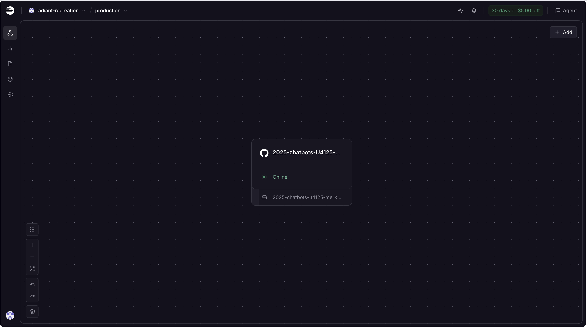
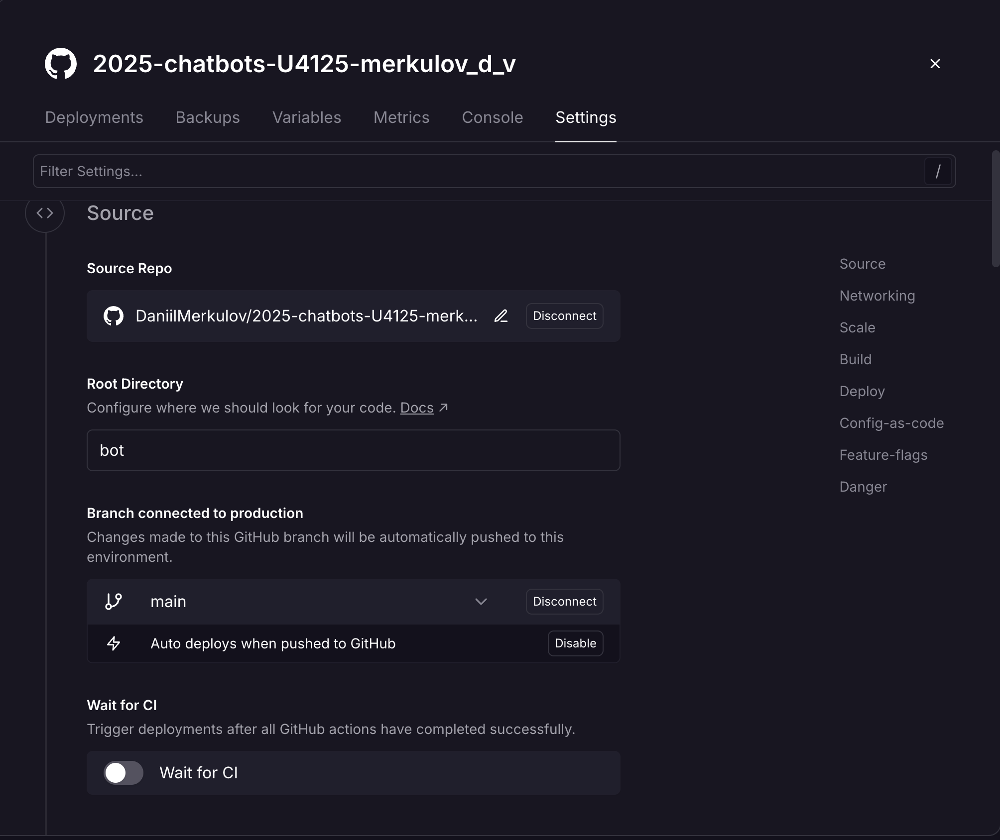
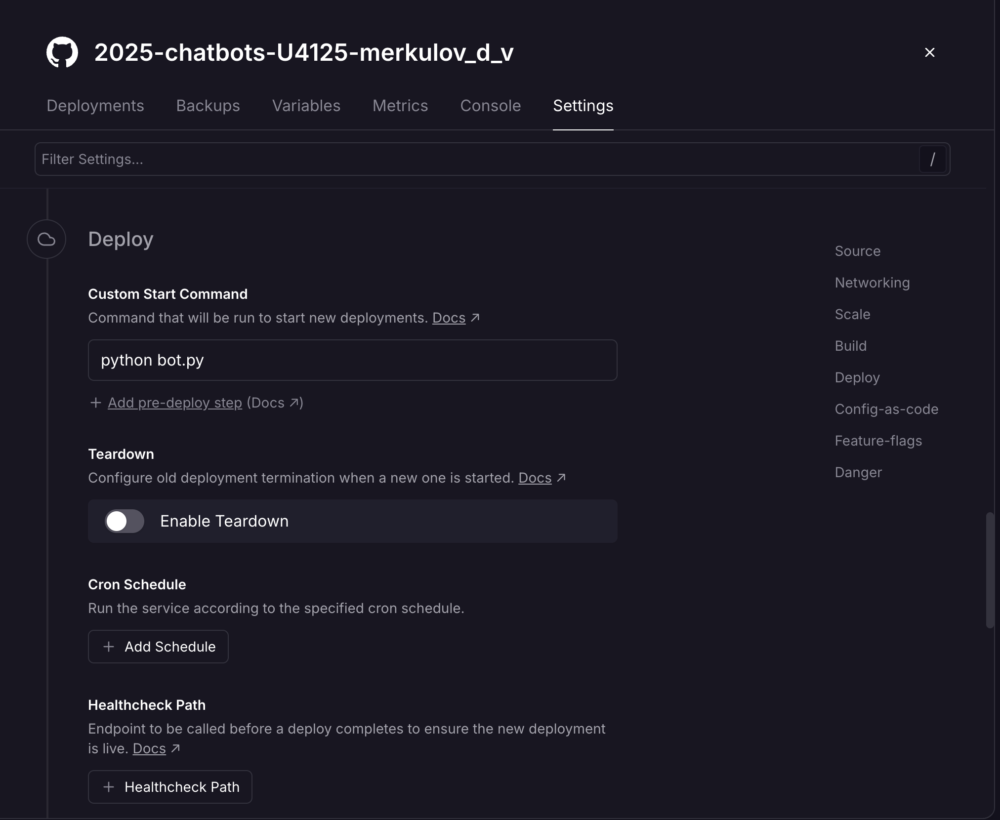
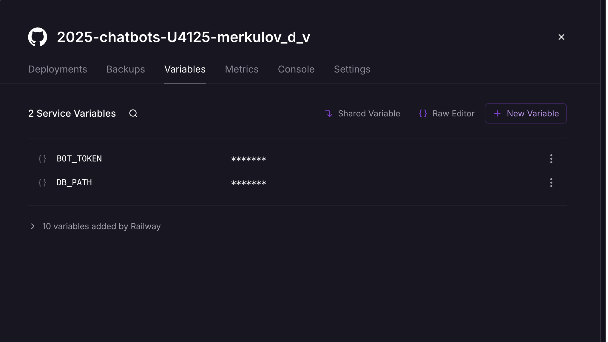
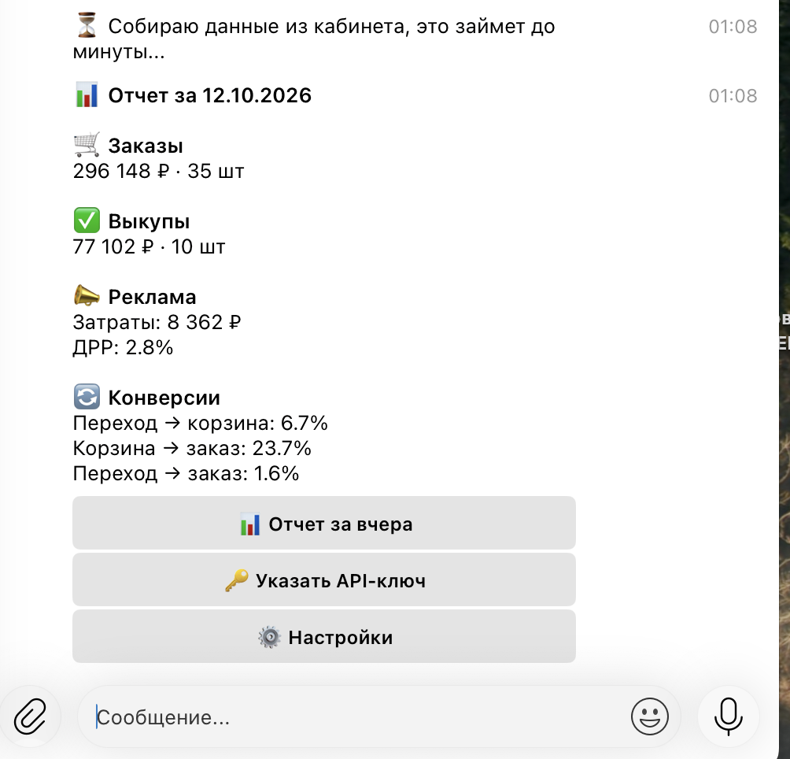
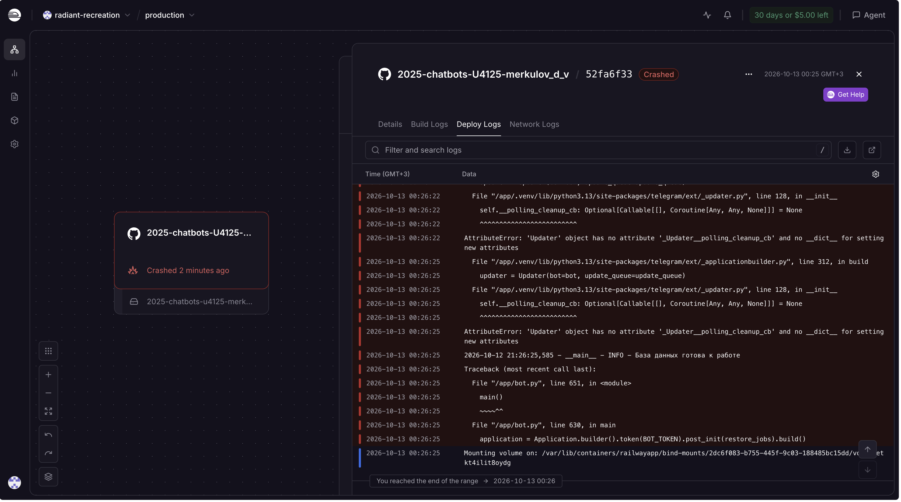

University: [ITMO University](https://itmo.ru/ru/)
Faculty: [FICT](https://fict.itmo.ru)
Course: [Vibe Coding: AI-боты для бизнеса](https://github.com/itmo-ict-faculty/vibe-coding-for-business)
Year: 2025/2026
Group: U4125
Author: Merkulov Daniil Vyacheslavovich
Lab: Lab3
Date of create: 12.10.2026
Date of finished: [указать после защиты]

## Описание деплоя

До этой работы бот жил только пока у меня открыт терминал. Закрыл ноутбук, и бот умер. Для утренней рассылки это бессмысленно: сводка должна приходить в девять утра независимо от того, включен у меня компьютер или нет.

Из трех вариантов в методичке выбрал облачный хостинг Railway. Вариант с ngrok отпадает сразу: он все равно требует включенного компьютера. Docker на своем сервере интереснее, но дольше, а Railway разворачивает проект прямо из репозитория GitHub, и для бота на Python ему даже не нужен Dockerfile, он сам определяет тип проекта и ставит зависимости из `requirements.txt`.

Еще один плюс: новому аккаунту дают 5 долларов на 30 дней. Бот почти ничего не потребляет, так что на период работы хватает.

**Бот:** [@itmoftmi_mdv_bot](https://t.me/itmoftmi_mdv_bot)

### Почему у бота нет публичного адреса

В методичке после деплоя предлагается настроить webhook и получить адрес вида `https://your-app.railway.app`. У меня его нет, и это не упущение.

Есть два способа, которыми бот узнает о новых сообщениях:

- **Webhook**: у бота есть публичный адрес, и Telegram сам стучится на него, когда кто-то написал. Нужен сервер, который слушает порт и имеет домен.
- **Polling**: бот сам раз в секунду спрашивает у Telegram, нет ли новостей. Никакого адреса не требуется.

Мой бот работает вторым способом. Он не слушает никакой порт, поэтому Railway и не выдает домен. Для бота с парой пользователей polling проще: не нужен ни домен, ни сертификат, и настраивать нечего. Webhook выигрывает при больших нагрузках, когда постоянные опросы становятся накладными.

### Как разворачивал

Сначала подготовил репозиторий. Код бота вынес в отдельную папку `bot`, чтобы сервер брал именно его, а не папки с отчетами. Рядом положил `Procfile` с командой запуска.

Дальше в Railway:

1. Создал проект из репозитория GitHub, выдав доступ к нужному репозиторию
2. В настройках сервиса указал **Root Directory** = `bot`, иначе сборка ищет `requirements.txt` в корне и падает
3. Прописал **Custom Start Command** = `python bot.py`
4. Добавил переменные `BOT_TOKEN` и `DB_PATH`
5. Подключил том на путь `/data`

Отдельно про том. Файловая система контейнера живет только до следующего обновления: выложил новую версию кода, и все созданные файлы пропали. А у меня в SQLite лежат API-ключи пользователей, то есть при каждом обновлении всем пришлось бы вводить ключ заново. Том это отдельное хранилище, которое переживает перезапуски. Поэтому база лежит по пути `/data/bot_database.db`, а сам путь задается переменной `DB_PATH`, чтобы локально и на сервере база лежала в разных местах без правки кода.

Токен бота на сервер не попадает через репозиторий. Он задан переменной окружения прямо в Railway, в коде его нет, в GitHub тоже.

## Трудности и решения

**Сборка падала сразу.** Railway искал код в корне репозитория, а там только папки лабораторных. Решилось настройкой Root Directory.

**Бот падал из-за версии Python.** Логи показали ошибку `'Updater' object has no attribute '_Updater__polling_cleanup_cb'`. Оказалось, Railway собирает проект на Python 3.13, а библиотека `python-telegram-bot` версии 20.7 с ним несовместима. Локально у меня Python 3.10, поэтому проблема вылезла только на сервере. Положил в папку с ботом файлы `.python-version` и `runtime.txt`, которые явно задают версию 3.11.

Для себя отметил: на сервере окружение другое, чем на ноутбуке, и версии нужно фиксировать не только у библиотек, но и у самого Python.

**База не открывалась.** После того как я прописал путь `/data/bot_database.db`, бот снова упал: папки `/data` еще не существовало, том я добавил позже. Порядок важен.

**Wildberries отказывал по лимитам.** Самая долгая история. Бот отвечал «Wildberries ограничивает частоту запросов». Выяснилось два разных повода. Во-первых, каждое нажатие кнопки запускало новый поход в API, и если нажать несколько раз, запросы начинали мешать друг другу. Во-вторых, лимиты зависят от типа токена: у базового токена без секретного ключа разрешен один запрос в два-три часа, а у персонального один в минуту. Поменял токен на персональный и доработал бота.

## Сбор фидбека

Ссылку на бота отправил знакомым, кто работает с маркетплейсами. Отозвались двое. Людей из этой сферы в моем окружении мало, поэтому выборка небольшая, зато оба действительно работают с товаром и смотрели на бота с точки зрения своей работы, а не просто «нажал кнопку, что-то пришло».

Вопросы задавал по методичке: что понравилось, что не понравилось, что улучшить, стали бы пользоваться.

## Анализ фидбека

**Что понравилось обоим.** Оба оценили одно и то же: быстро увидеть картину прошедшего дня, не заходя в кабинет. Первый отзыв: «для понимания первоначальной картины о происшедшем дне самое то», и дальше важная мысль про то, что по сводке можно вовремя заметить, что менеджеры что-то упустили, и подключиться, а причины искать уже потом. Второй отозвался про удобство мониторинга.

**Что не понравилось.** Претензий не было ни у кого. Про удобство интерфейса, набор показателей и формат сообщения вопросов не возникло, то есть сводка читается без пояснений.

**Что улучшить.** Первый сказал, что для этой задачи хватает всего. Второй предложил развитие: привязать данные о себестоимости, чтобы бот считал маржинальность и прогноз прибыли.

**Приоритеты.** Предложение про маржинальность по смыслу верное, но упирается не в код, а в данные: себестоимость товара в API Wildberries не лежит, ее нужно откуда-то брать. Либо продавец заносит ее в бота руками по каждому артикулу, либо подключать внешнюю таблицу или учетную систему. Это отдельная работа, и я вынес ее в планы, а не в текущие правки.

Поэтому правки, которые я внес, появились не из пожеланий пользователей, а из того, что вылезло при реальном использовании после деплоя.

## Улучшения

**Кэш готовых отчетов на 30 минут.** Раньше каждое нажатие кнопки означало четыре запроса в Wildberries. Теперь результат запоминается, и повторный запрос за тот же день приходит мгновенно. Данные за прошедший день все равно уже не меняются, так что смысла ходить за ними снова нет. Это и ускорило ответ, и сняло часть упоров в лимиты.

**Защита от повторных нажатий.** Пока бот собирает отчет, он помечает пользователя как занятого, и второе нажатие не запускает новый поход в API, а отвечает «уже собираю, подождите». Раньше нетерпеливое нажатие кнопки несколько раз подряд делало только хуже: запросы накладывались и сами же упирались в лимит.

**Терпеливое ожидание лимитов.** Wildberries в ответе на отказ присылает заголовок с числом секунд, которые нужно подождать. Бот теперь читает его и ждет столько, сколько сказано, до полутора минут, и повторяет запрос, максимум три раза. Для пользователя это значит, что вместо ошибки он просто получит отчет чуть позже.

**Понятные тексты ошибок.** Вместо «не удалось получить данные» бот теперь объясняет, что именно не так: ключ не принят, не хватает категорий доступа, или превышен лимит и надо подождать. Это пригодилось в первый же день, потому что по тексту ошибки я понял, в чем проблема, без чтения логов.

## Выводы

Бот работает сам по себе, на сервере, круглосуточно. Утренняя рассылка приходит независимо от того, включен у меня ноутбук или нет. Это и было целью.

Главное, что я вынес: разница между «работает у меня» и «работает на сервере» больше, чем кажется. Локально все запускалось без единой ошибки, а на сервере вылезло четыре проблемы подряд, и три из них к коду отношения не имели. Другая версия Python, другая файловая система, другой порядок настройки. Поэтому логи оказались главным инструментом: каждый раз ответ был именно в них, а не в догадках.

Второе наблюдение про обратную связь. Я ждал замечаний по интерфейсу, а получил другое: оба собеседника говорили не про кнопки, а про то, зачем им это нужно. Ценность оказалась не в наборе показателей, а в том, что сводка приходит сама. При этом ни один из них не попросил добавить показателей, хотя я был уверен, что попросят.

Что можно улучшить дальше: себестоимость и маржинальность, как предложил один из пользователей, и сравнение с предыдущим днем, чтобы сразу видеть, выросло или упало. Еще стоит перенести базу с SQLite на полноценную, если пользователей станет много.
